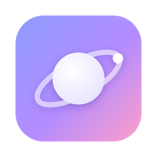
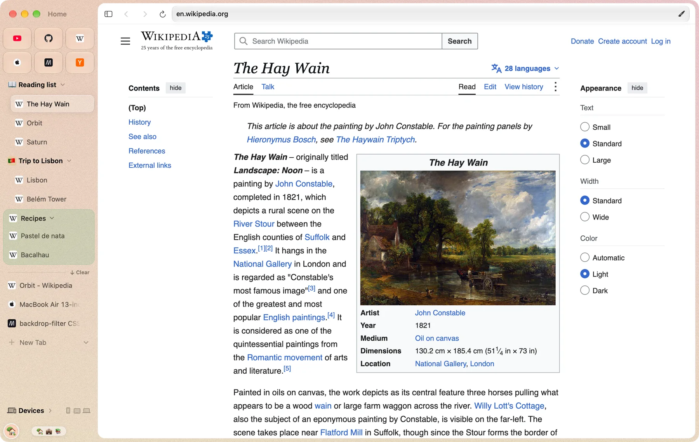
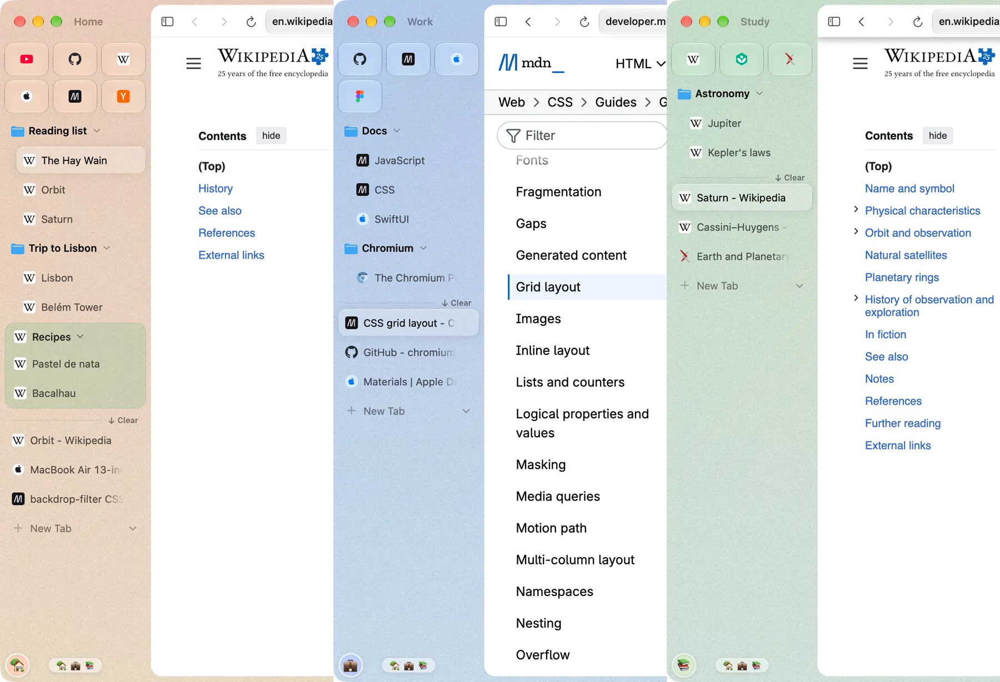
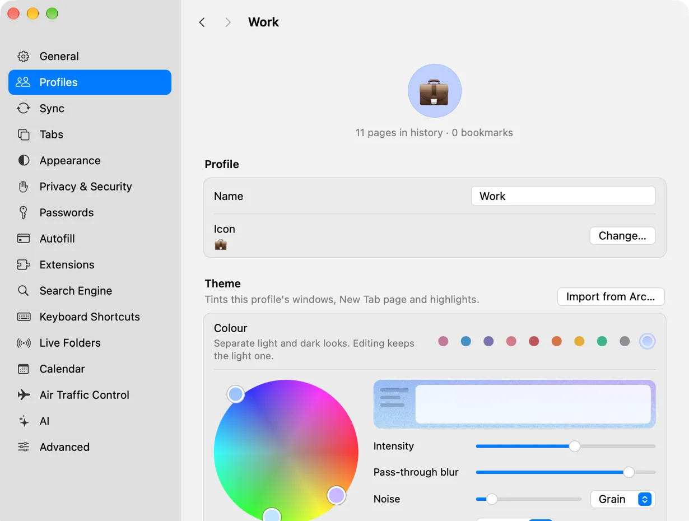
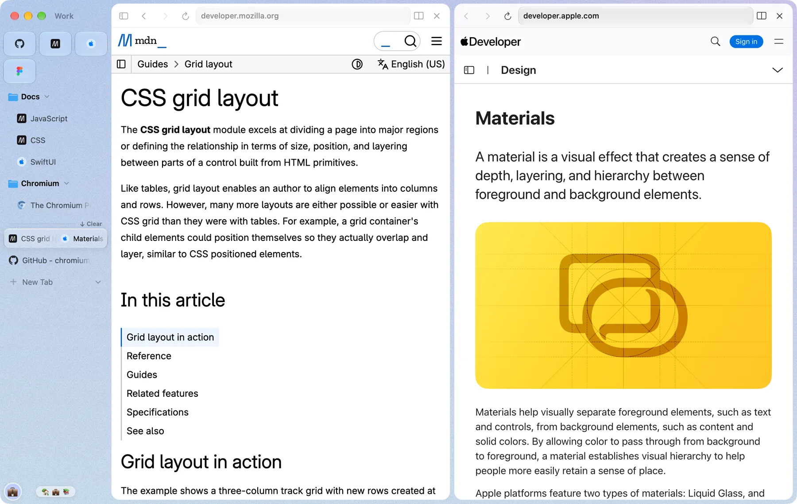
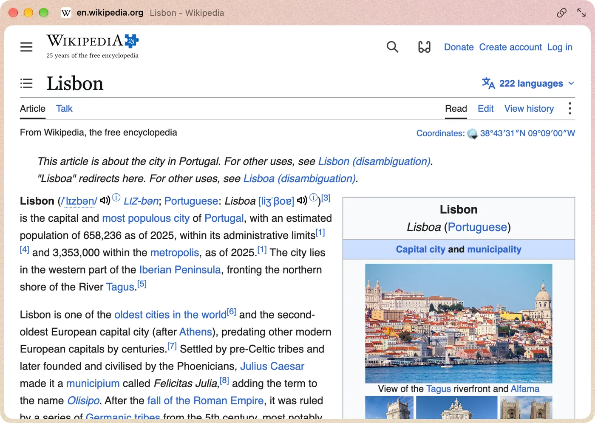
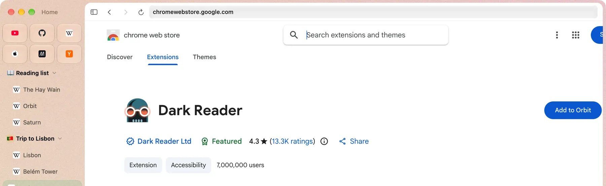
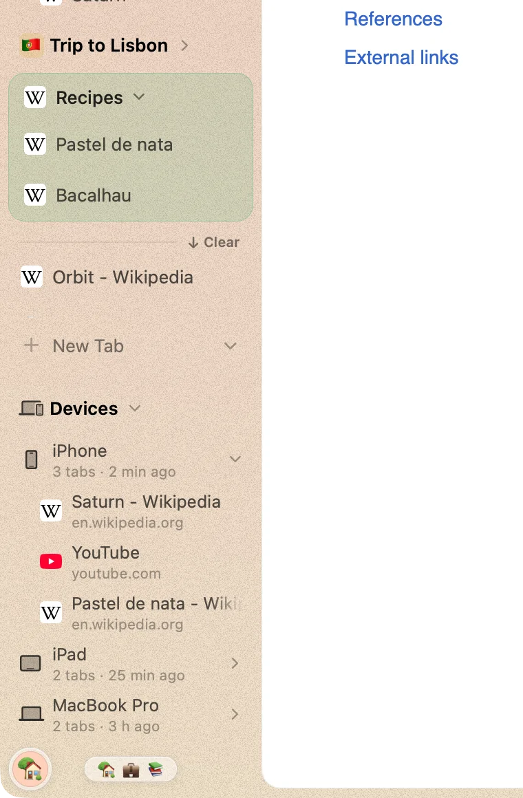
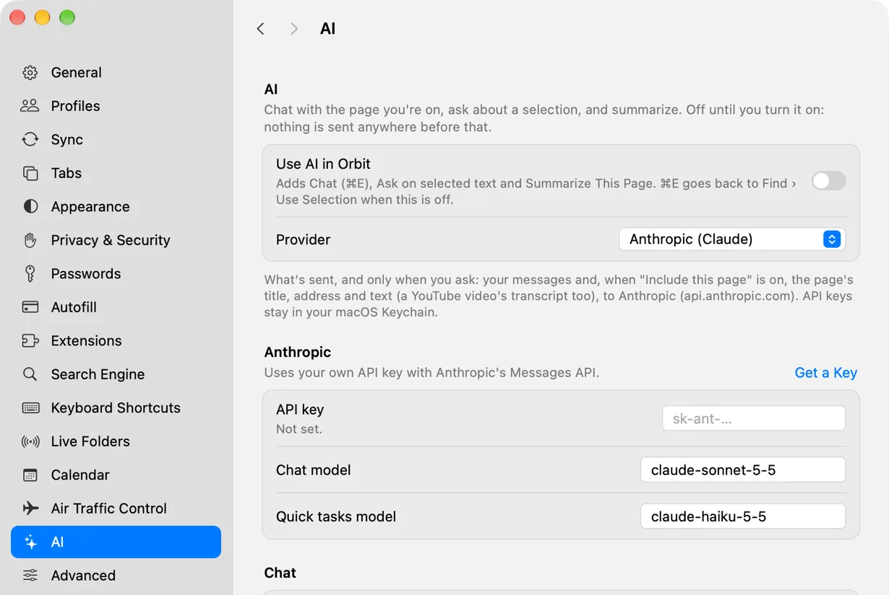
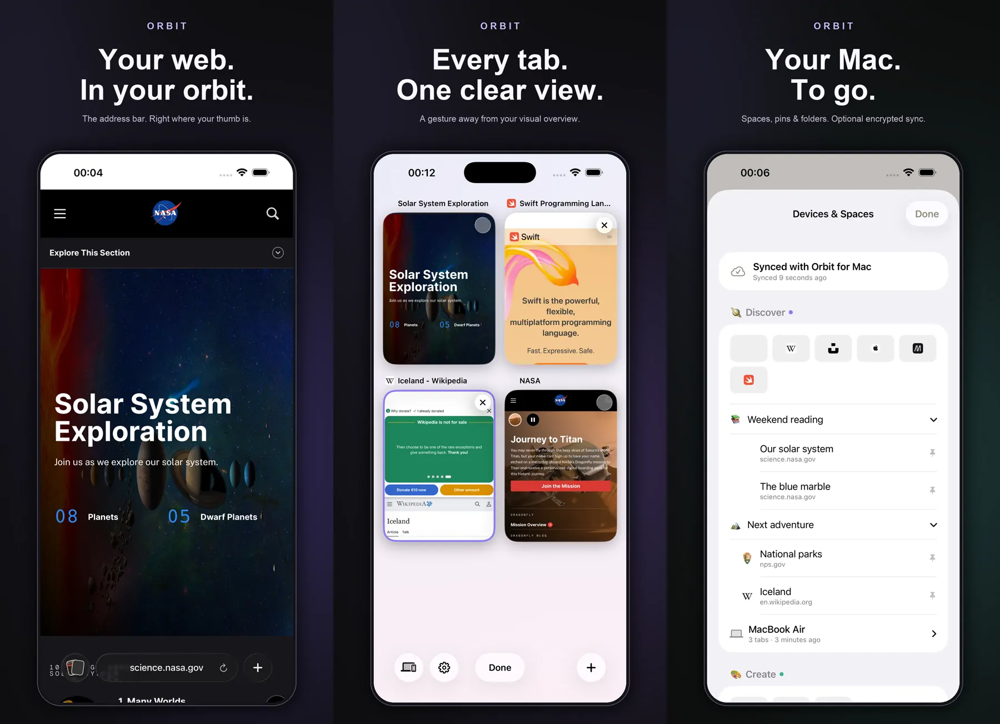

<p align="center">
  
</p>

<h1 align="center">Arc, back in orbit.</h1>

<p align="center">
  Spaces, pinned tabs, folders and a glass sidebar, on real Chromium.<br>
  Free and open source. Ads and trackers stay out.
</p>

<h3 align="center">
  <a href="https://github.com/SPRTCS/orbit/releases/latest/download/Orbit-1.0.0.dmg">Download Orbit 1.0.0 for Mac</a>
</h3>

<p align="center">
  macOS 14 Sonoma or later · Apple Silicon · Notarized by Apple<br>
  On an iPhone or iPad? <a href="apps/mobile">Orbit for iPhone and iPad</a> is coming to the App Store.<br>
  <a href="https://github.com/SPRTCS/orbit/releases">All releases</a> · <a href="https://github.com/SPRTCS/orbit/issues">Issues</a> · <a href="#build-it-yourself">Build it yourself</a>
</p>

<p align="center">
  <picture>
    <source media="(prefers-color-scheme: dark)" srcset="docs/screenshots/window-dark.webp">
    
  </picture>
</p>

## The sidebar you missed.

Pinned tiles up top, folders inside folders below, today's tabs under the line. ⌘D pins a tab, drag anything onto a
folder to file it, and give a folder an emoji and a colour while you're at it. Tabs you haven't touched sweep
themselves into Recently Cleaned with ⌥⌘K.

## One of you per space.

Work, Home, that side project: each space has its own pins, folders, logins, extensions and look. Swipe the sidebar
or press ⌃1 to ⌃9 to hop between them.



## Glass, tinted to taste.

The sidebar is glass and the desktop shows through. Drag up to three colours around the wheel, set the blur and the
grain, pick separate light and dark looks, or bring your theme over from Arc.



## Two pages, one window.

Drag a tab onto the page. Up to three panes, side by side or stacked.



## Little Orbit, for drive-by links.

⌥⌘N, or click a link in another app: a small window with one page and no sidebar. Keep it with ⌘O, toss it with Esc.
Air Traffic Control decides which links go where, down to the space.



## Your extensions come along.

The Chrome Web Store just works, and its button says Add to Orbit.



## Ads and trackers stay out.

The full uBlock Origin is built in and on from the first page. Cookie banners are one switch away. Google's pings are
compiled out, and Orbit collects nothing: telemetry is off, and there's no account and no server of ours.

## Your tabs, on every device.

Sync runs end-to-end encrypted through a folder in your own iCloud Drive, unlocked by a 24-word phrase that never
leaves your devices. Your other Macs, iPhone and iPad show up in the sidebar's Devices section, open tabs and all.



## Moving out of Arc? Bring the furniture.

Arc's spaces, pinned tabs, folders and themes come across, nesting and all. From Dia: bookmarks, history, passwords and
logins, plus its open and pinned tabs. Chrome, Safari, Firefox, Edge, Brave, Vivaldi, Opera, Helium and a few more
work too.

## AI, off until you say so.

Turn it on and you get a chat beside the page, Ask about a selection, Summarize This Page and Tidy Tabs, through your
own key: Anthropic, or any OpenAI-compatible server, Ollama and LM Studio on your Mac included. Turn it off and the
menus, the shortcut and the requests go with it.



## Let your agents drive. Or don't.

The `orbit` command reads and drives the Orbit you have open. `orbit mcp` hands it to AI agents over MCP, one space at
a time, and only after you've allowed both in Settings › Advanced. Nothing is allowed by default.

```sh
orbit exec 'await tab.title()'
orbit mcp install --target claude-code
```

Claude Code, Claude Desktop, Codex and Cursor are one `--target` away. The tools and permissions are in
[docs/mcp.md](docs/mcp.md).

## In your pocket, too.

Orbit for iPhone and iPad is a quick browser with the address bar at your thumb, a tab overview a swipe away, and
your Mac's spaces, pins and open tabs synced in. It's [in this repo](apps/mobile) and coming to the App Store.



## Also in there

- **Picture in picture.** Switch tabs mid-video and it floats along in the corner. Go back and it slips into the page.
- **Boosts.** Restyle any site with your own CSS and JavaScript, or zap the bits you never wanted to see.
- **Air Traffic Control.** Rules for where links from Mail, Slack and friends open: a space, Little Orbit, or here.
- **Shared spaces.** Send a space or a folder as a `.orbitspace` file, or subscribe to a shared one and stay in step.
- **Sessions and a timeline.** Save a space's tabs for later, or slide back through the last 30 days of it.
- **Capture.** ⇧⌘2 grabs an element, an area or the whole page, straight to the clipboard.
- **Groups on contact.** Drop a tab on a tab and they're a group, named for you.
- **Command bar.** ⌘L finds tabs, history and bookmarks, runs commands and does your sums.
- **Clean links.** Copy a link and the tracking junk stays behind.
- **Private windows.** ⇧⌘N. They forget everything when the last one closes.
- **Updates itself.** Quietly, from this repo's releases.

## It's actually Chromium.

Not WebKit. Not Electron. Every window is Chrome's own, so sites, extensions and DevTools behave like they do in Chrome.

| Part | Details | Status |
| --- | --- | --- |
| Engine | Chromium 155, on Chrome's own framework. | ✓ Yes |
| De-Googled | ungoogled-chromium underneath. | ✓ Yes |
| H.264 and AAC | The codecs Chromium leaves out. | ✓ Yes |
| DevTools | Docked, with device mode. Like Chrome. | ✓ Yes |
| Sync | End-to-end encrypted, through your own iCloud Drive. | ✓ Yes |
| Translate | On your Mac. Nothing leaves it. | ✓ macOS 26 |
| Passkeys | Touch ID yes. iCloud Keychain waits on Apple. | ~ Partly |
| Widevine | Google hasn't signed off. So no Netflix. | ✗ Not yet |
| Intel Macs | Apple Silicon only. | ✗ No |

<h3 align="center">
  <a href="https://github.com/SPRTCS/orbit/releases/latest/download/Orbit-1.0.0.dmg">Download Orbit 1.0.0</a>
</h3>

<p align="center">
  One drag into Applications.<br>
  Want to hear about the next one? Watch › Custom › Releases up top.
</p>

---

# Build it yourself

Orbit is a fork of [Ardia](https://github.com/mantrakp04/ardia), a Dia-style browser built on Chrome's own framework
(ArdiaCore, a thin layer over our patched Chromium) with a React Native macOS shell. Orbit takes it towards Arc:
spaces, folders, Boosts, Air Traffic Control, the glass sidebar, opt-in AI, and an iPhone and iPad app.

## Run it

You need an Apple Silicon Mac on macOS 14 or later, Xcode 26, CocoaPods, Node 22.13+ and pnpm 11. You don't need to
build Chromium: the first step downloads the prebuilt engine that matches `engine/`.

```sh
pnpm install && packages/ardiacore/scripts/fetch-engine.sh && pnpm pods
pnpm dev
```

Leave Metro running, and in another terminal build the Debug app and launch it hidden, on throwaway data:

```sh
cd apps/browser && xcodebuild -workspace macos/Ardia.xcworkspace -scheme Ardia-macOS \
  -derivedDataPath ~/Library/Caches/Orbit/build -destination 'platform=macOS,arch=arm64' \
  -configuration Debug -xcconfig macos/AdHoc.xcconfig
cd ../.. && scripts/agent/ac launch ~/Library/Caches/Orbit/build/Build/Products/Debug/Ardia.app --data /tmp/orbit-test
```

`AdHoc.xcconfig` signs ad hoc, so you need no provisioning profile. Keep derived data outside iCloud Drive: `codesign`
refuses a bundle that iCloud has tagged. Passkeys need a team-signed build. The app is still called `Ardia.app` inside
the build folder; that's on purpose (see below).

The iPhone and iPad app builds on its own with XcodeGen: [apps/mobile/README.md](apps/mobile/README.md).

## How Orbit stays mergeable

Orbit follows Ardia's releases, so it changes as little of Ardia as it can:

- **Orbit layers.** Every Orbit feature lives in its own files, with the smallest possible hook in an upstream file.
  Each hook is listed in [docs/orbit.md](docs/orbit.md) › "Orbit layers and their hooks in upstream files", so a merge
  conflict is a lookup, not an archaeology dig.
- **Branding by script.** `node scripts/orbit/rebrand.mjs` turns Ardia into Orbit after each upstream merge, and
  `--check` says whether anything slipped. Internal names (`Ardia.xcodeproj`, `ArdiaCore`, `ARDIA_*`) stay as they are.
- **Branches.** `orbit` is Orbit; `main` mirrors upstream. Send pull requests to `orbit`.

| Path | What |
| --- | --- |
| `apps/browser` | The React Native macOS app: UI, store, actions |
| `apps/mobile` | Orbit for iPhone and iPad (SwiftUI, WebKit) and its sync package |
| `apps/cli` | The `orbit` command and the MCP server |
| `packages/ardiacore` | The engine layer: Chrome's framework and the native modules the app calls |
| `packages/shell` | Menus, shortcuts, windows, native views |
| `packages/core` | Omnibox parsing and suggestions, pure TypeScript with tests |
| `packages/import`, `packages/sync`, `packages/shaders` | Importing from other browsers, sync, Metal views |
| `engine/` | Ardia's Chromium patches. Orbit keeps it byte-identical to upstream |

## Where to start

- Read [CONTRIBUTING.md](CONTRIBUTING.md), then [docs/orbit.md](docs/orbit.md) for what Orbit adds and
  [docs/agent-brief.md](docs/agent-brief.md) for the architecture and the test harness.
- Pick something from [Issues](https://github.com/SPRTCS/orbit/issues), or a 🟡 row in
  [docs/dia-feature-parity.md](docs/dia-feature-parity.md). Arc features Orbit doesn't have yet are fair game too:
  open an issue first so we can agree on the shape.
- Found a bug? An issue with a screen recording is the fastest one to fix.

## License

Orbit is licensed under the [Apache License 2.0](LICENSE); the iPhone and iPad app in `apps/mobile` is
[MIT](apps/mobile/LICENSE). Orbit is built on [Ardia](https://github.com/mantrakp04/ardia) by Mantra Patel. It builds
on Chromium and ungoogled-chromium and bundles uBlock Origin, each under its own license; see [NOTICE](NOTICE).
Orbit is made by AIS Consulting UG.
